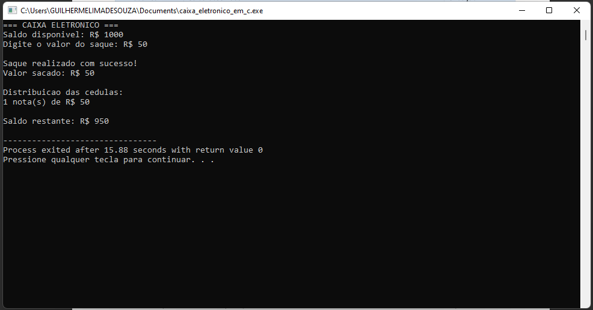
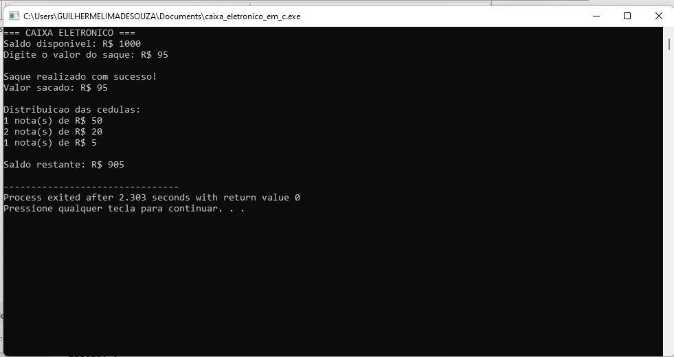
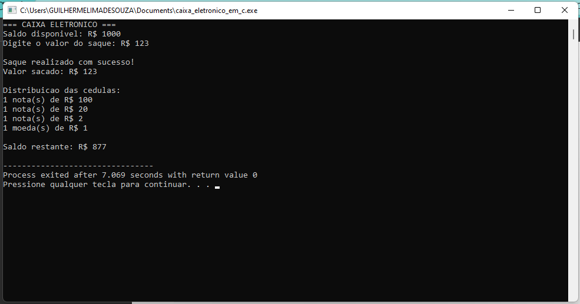
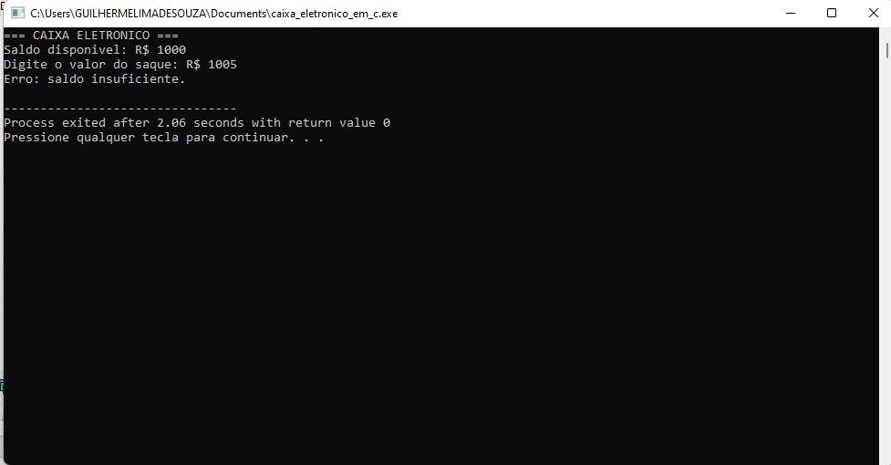

# Relatório de Testes — Sistema de Caixa Eletrônico em C

## 1. Objetivo

Documentar os testes de execução do simulador de caixa eletrônico desenvolvido em linguagem C como atividade prática universitária. O programa verifica o valor solicitado e o saldo disponível, distribui as denominações de R$ 100, R$ 50, R$ 20, R$ 10, R$ 5, R$ 2 e moeda de R$ 1, e atualiza o saldo após um saque válido.

## 2. Sequência lógica

1. Declarar saldo, valor solicitado, valor restante e contadores de denominações.
2. Solicitar e ler um valor inteiro de saque.
3. Rejeitar valores menores ou iguais a zero.
4. Rejeitar valores superiores ao saldo disponível.
5. Calcular a distribuição por divisão inteira e módulo, da maior para a menor denominação.
6. Exibir apenas as denominações utilizadas.
7. Descontar o saque do saldo e mostrar o saldo restante.

## 3. Variáveis principais

| Variável | Tipo | Finalidade |
|---|---|---|
| `saldo` | `int` | Saldo inicial de R$ 1.000 |
| `saque` | `int` | Valor solicitado |
| `restante` | `int` | Valor ainda não distribuído |
| `nota100`, `nota50`, `nota20`, `nota10` | `int` | Contagem de cédulas |
| `nota5`, `nota2`, `moeda1` | `int` | Contagem de cédulas e moeda |

## 4. Implementação

O programa utiliza `scanf()` para entrada de dados, `if`/`else` para validação, divisão inteira (`/`) e módulo (`%`) para distribuir as denominações, e `printf()` para exibir os resultados. Cada execução começa com saldo de **R$ 1.000**.

Na versão original, a moeda de R$ 1 permite compor qualquer valor inteiro positivo que não ultrapasse o saldo; não é necessário exigir múltiplos de 2 ou 5.

## 5. Evidências dos testes

| Teste | Saque solicitado | Resultado registrado | Saldo após o teste |
|---|---:|---|---:|
| 01 | R$ 50 | 1 nota de R$ 50; saque aceito | R$ 950 |
| 02 | R$ 95 | 1 nota de R$ 50, 2 de R$ 20 e 1 de R$ 5; saque aceito | R$ 905 |
| 03 | R$ 123 | 1 nota de R$ 100, 1 de R$ 20, 1 de R$ 2 e 1 moeda de R$ 1; saque aceito | R$ 877 |
| 04 | R$ 1.005 | Saque recusado por saldo insuficiente | R$ 1.000 (inalterado) |

### Teste 01 — Saque de R$ 50

**Resultado:** saque realizado com uma nota de R$ 50; saldo restante de R$ 950.

[Ver imagem do teste 01](image/teste_01.png)

### Teste 02 — Saque de R$ 95

**Resultado:** uma nota de R$ 50, duas notas de R$ 20 e uma nota de R$ 5; saldo restante de R$ 905.

[Ver imagem do teste 02](image/teste_02.png)

### Teste 03 — Saque de R$ 123

**Resultado:** uma nota de R$ 100, uma nota de R$ 20, uma nota de R$ 2 e uma moeda de R$ 1; saldo restante de R$ 877.

[Ver imagem do teste 03](image/teste_03.png)

### Teste 04 — Saque de R$ 1.005

**Resultado:** operação recusada por saldo insuficiente.

[Ver imagem do teste 04](image/teste_04.png)

## 6. Conclusão

As quatro evidências presentes no relatório original mostram três saques válidos com distribuição de denominações e atualização do saldo, além de uma solicitação recusada por saldo insuficiente. O código também contém verificações para entradas não inteiras e valores não positivos, mas o PDF não apresenta capturas específicas desses cenários.

---

**Contexto:** atividade prática universitária de programação em linguagem C.
